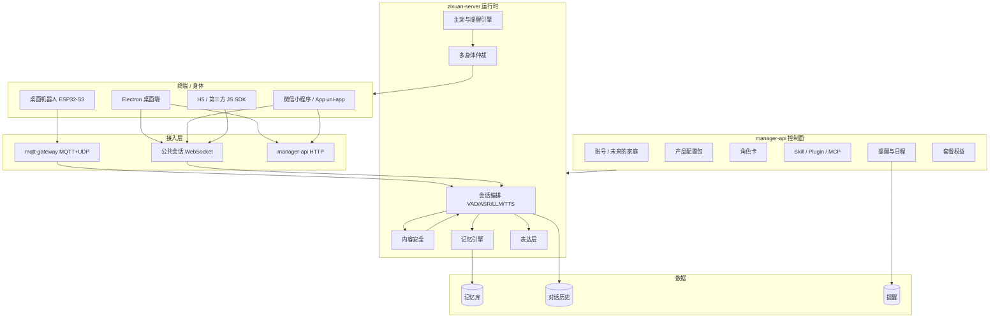
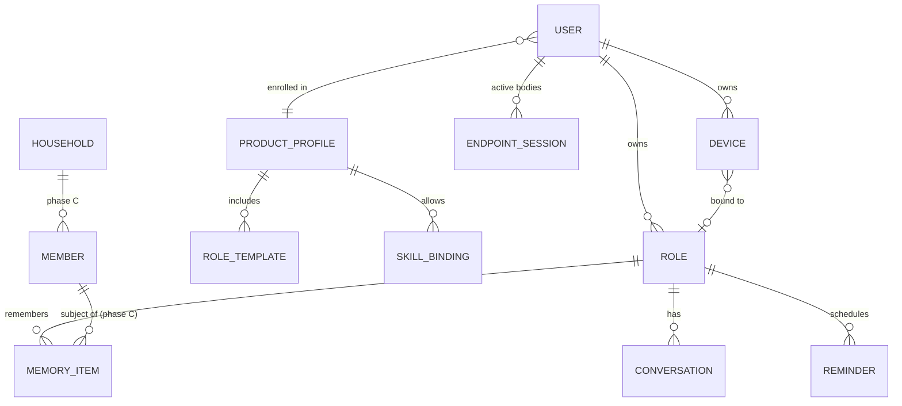

# 产品与平台设计方案（v1，2026-10）

> 适用范围：AI Plush Companion 从"硬件语音对话后端"演进为"C 端陪伴平台 + 可拆分的垂直产品"。首发产品已确定为**桌面陪伴机器人 + 办公/生活助理**。
>
> 背景调研见 `docs/research/2026-10-competitive-analysis-and-direction.md`。本文中"现有"指截至 2026-10-02 仓库里已有的代码和文档；"未发现"指按关键词检索仓库后没有找到对应实现，落地前请再确认一次。

## 目录

1. 我可以改进的点
2. 需要补充的点
3. 后续的方向
4. 我能做以及需要做的事情
5. 后续的产品测试
6. 完整设计方案

---

## 1. 我可以改进的点

这一节针对**已经存在、但定位或实现需要调整**的部分。

**1.1 把"本地记忆"改成"用户拥有的记忆"。** 现在的记忆存储在服务端，由 `zixuan-server/core/providers/memory` 下的 tencentdb、mem0ai、powermem、mem_local_short 等实现，ADR 0006 规定按"用户 + 角色"归属。这个架构没问题，但"完全存储在用户本地"的说法目前不成立，而且只要使用云端 LLM，记忆内容就会出现在提示词里。对外承诺应改为四点：存储位置可选（官方云加密存储 / 自部署 / 家庭中枢），记忆可查看、可编辑、可导出、可彻底删除，以及明确告知哪些内容会发给模型供应商。技术上要补导出、来源标注和加密，详见 6.6。

**1.2 降低部署门槛。** 现在一套完整服务需要 Java manager-api、Python zixuan-server、MQTT 网关、MySQL/Redis、记忆服务以及多个前端。对 C 端用户来说，"自部署"几乎不可行。建议提供两种形态：官方托管（默认），以及"桌面端即服务"，即在 Electron 里内置一个精简运行时，充当家庭中枢（见 6.9）。后者是让"本地"真正落地的关键。

**1.3 把声音、音色、性格从"卖点"降为"基础体验"。** 这些能力（`timbre`、`voiceclone` 模块）同类产品都有，继续保留，但投入方向从"能配"转为"配得好"：高质量的预设角色、即时试听、改完立即在设备上生效。

**1.4 主动陪伴从"空闲触发"升级为"事件驱动"。** 现有的 `core/companion/proactive_planner.py` 已经有固定规则、全局提示词和角色级指引，陪伴模式（`turn_based` / `proactive`）挂在设备上。可改进三处：触发源从"空闲多久"扩展为提醒到期、待跟进事项、时间段、在场检测和桌面事件；策略增加免打扰时段、频率上限，以及"被拒绝后自动降频"；陪伴模式从设备级挪到角色级或产品配置包级，保证同一个角色在所有身体上行为一致。

**1.5 把情绪策略扩展成"表达层"。** `core/companion/emotion_policy.py` 目前把 7 种情绪映射为屏幕表情和 TTS 情绪、语速、音高。它就是表达层的雏形，下一步加入动作（点头、转头、天线、灯效），并改成按设备能力映射，详见 6.8。

**1.6 唤醒词与角色绑定。** 动态唤醒词现在是设备级能力（`docs/dynamic-device-wake-word.md`），而角色切换时唤醒词和应答语最好跟着变。建议在角色卡里增加 `wake_word` 和 `greeting` 字段：设备切换角色时，如果设备支持动态唤醒词，就下发新唤醒词；不支持时保持原值，只切换应答语。

**1.7 收敛前端。** 现有前端包括 `companion-console`（React 管理台）、`companion-web`（Next.js 对话应用）、`manager-mobile`（uni-app 移动管理端）和 `digital-human`。建议按受众收敛：运营管理只保留 `companion-console`；消费者端只保留两条线，一条是 uni-app（同时出 App 和微信小程序，`manager-mobile` 已有 `build:mp` 脚本），另一条是 Web/Electron（基于 `companion-web` 加 JS SDK）。`digital-human` 评估后决定并入 Electron 宠物窗口，或者归档。

**1.8 明确上游同步策略。** 项目已和 xiaozhi-esp32-server、xiaozhi-esp32 明显分叉。建议写一份 ADR：固件侧定期合并上游（板级支持和协议修复价值高），服务端只保持协议兼容、不再整体合并，按需摘取 provider 适配代码。

**1.9 记忆质量要可度量。** 目前有记忆管理的增删改查（`MemoryProviderBase` 的 list/update/delete/clear/add），但还没有质量评估。主打记忆，就必须有评测集和指标（见第 5 节）。

---

## 2. 需要补充的点

这一节是**目前未发现实现、但首发产品需要**的能力，按优先级排列。

| 优先级 | 能力 | 为什么需要 | 现有可复用基础 |
|---|---|---|---|
| P0 | 备忘、提醒、日程 | 办公/生活助理场景下使用频率最高，也是主动开口最自然的理由 | ProactivePlanner、Skill/Plugin 体系、设备下行播报 |
| P0 | 内容安全层（输入/输出审核、角色级策略、危机话题处理） | C 端上线的硬性条件 | 对话主链路的事件流可以插入审核环节 |
| P0 | 产品配置包（Product Profile） | 平台拆分垂直产品的核心抽象 | `CompanionTemplate`（预设）、`CompanionSubscription`/`Plan`（套餐权益） |
| P0 | 消费者端：Electron 桌面端 + 小程序/App | 首发产品的主要入口 | `companion-web`、`docs/api/public-conversation-*.js`、`manager-mobile`（uni-app） |
| P1 | 表达协议 + 舵机驱动 | 桌面机器人的差异化体验 | EmotionPolicy、固件里上游的舵机动作示例 |
| P1 | JS SDK（会话、实时语音、事件） | H5、Electron、第三方都需要 | `docs/api/` 下已有浏览器端会话、实时、VAD、发送队列脚本 |
| P1 | 记忆导出 / 导入、来源标注、加密 | 兑现"用户拥有的记忆" | MemoryProviderBase 管理接口 |
| P1 | 多身体仲裁（多个设备同时在线时由谁回应） | "一个灵魂，多个身体"的基础 | 会话与设备绑定模型 |
| P1 | 隐私中心与合规（AI 生成内容标识、声音复刻授权、数据删除） | 国内 C 端上线需要 | 已有的记忆删除、对话删除 |
| P2 | 家庭/成员模型 + 声纹关联到个人记忆 | 第二个垂直方向（老人/儿童）需要 | `core/utils/voiceprint_provider.py` |
| P2 | 角色卡导入（SillyTavern Character Card V2/V3） | 接入现成的角色生态 | 角色/Agent 模型 |
| P2 | 记忆评测集与回归测试 | 防止记忆质量退化 | pytest 体系 |
| P2 | C 端运营指标埋点 | 衡量留存和主动陪伴效果 | debug events |

关于合规：国内面向公众提供生成式 AI 服务，涉及《生成式人工智能服务管理暂行办法》、深度合成相关规定（声音复刻需要授权）、《人工智能生成合成内容标识办法》和《个人信息保护法》等。具体需要做备案、登记还是标识，取决于你用的模型和服务形态，上线前建议咨询专业的法律或合规人士。本文只列出需要预留的产品能力，不构成法律意见。

---

## 3. 后续的方向

**3.1 定位：** 一个用户拥有记忆的 AI 角色，可以住在多个身体里。平台是底座，对外以具体产品出现。

**3.2 产品路线：**

| 阶段 | 产品 | 目标 | 验证什么 |
|---|---|---|---|
| A | 桌面陪伴机器人 v0（带屏 ESP32 + 外壳）+ Electron 桌面端 | 办公/生活助理首发 | 用户会不会每天回来；提醒和主动陪伴是否有用、会不会打扰 |
| B | 机器人 v1（加舵机、触摸）+ 小程序 | 表达层和多身体接续 | 动作是否明显提升好感；跨设备接续是否被感知和看重 |
| C | 第二个垂直产品（独居老人或儿童），复用底座 | 用产品配置包拆出新产品 | 底座抽象是否正确，拆分成本是否可控 |
| D | 角色/技能/动作市场，开放 SDK | 平台化 | 第三方是否愿意在上面开发 |

**3.3 不做的事（至少在阶段 A、B 内）：** 移动底盘；自研芯片或音频算法；面向开发者的通用平台运营；同时推进多个垂直场景。

**3.4 竞争策略：** 硬件层借力 xiaozhi 生态（兼容现成开发板，降低硬件门槛）；体验层用"记忆 + 主动性 + 表达 + 多身体接续"拉开差距；信任层用"记忆归用户所有"建立长期壁垒。

---

## 4. 我能做以及需要做的事情

规模估算按一位全栈开发者计：S ≈ 1 周以内，M ≈ 1–3 周，L ≈ 3 周以上。只作相对参考。

### 4.1 现在就能做（主要复用现有代码）

| 事项 | 规模 | 说明 |
|---|---|---|
| 写 4 份 ADR：产品配置包、提醒引擎、表达协议、内容安全 | S | 先把边界定清楚，再写代码，和现有 ADR 的风格一致 |
| 从 `docs/api` 的浏览器脚本抽出 JS SDK | M | 会话创建、实时语音、事件订阅、取消、重连 |
| 用 Electron 包装 `companion-web`，做文字、通话和托盘 | M | 先不做本地运行时 |
| 把陪伴模式从设备级挪到角色级 | S | 设备侧保留覆盖开关 |
| 扩展 EmotionPolicy 输出 ExpressionIntent（先只驱动屏幕） | S | 为舵机预留字段 |
| 打磨 3 个首发预设角色（办公搭子、生活管家、温柔倾听者） | S | 包括提示词、音色、表情、主动策略 |
| 机器人 v0 外壳（3D 打印），屏幕即脸 | M | 可以参考固件里的 `firmware/enclosure` |

### 4.2 上线前必须做

| 事项 | 规模 | 说明 |
|---|---|---|
| 提醒/备忘/日程：数据模型、Skill 工具、调度器、多端投递 | L | 见 6.7 |
| 内容安全层：输入/输出审核、角色策略、危机话题兜底 | M | 见 6.10 |
| 产品配置包：数据模型、管理台页面、运行时加载 | M | 见 6.4 |
| 消费者 App/小程序：登录、配网绑定、角色、聊天、记忆管理、提醒 | L | 领域规则已在 `CONTEXT.md` 写好 |
| 记忆导出/导入、来源标注 | M | 见 6.6 |
| 多身体仲裁 | M | 见 6.9 |
| 隐私中心、AI 内容标识、声音复刻授权流程 | M | |
| 运营指标埋点和看板 | M | 见第 5 节 |
| 完成 `docs/project-requirements-audit.md` 里尚未完成的现场验收 | M | 包括 provider 故障、断网、NVS 保护等 |

### 4.3 可以晚一点做

舵机与动作库（阶段 B）、家庭成员模型（阶段 C）、角色卡导入、Electron 内置本地运行时（家庭中枢）、记忆端到端加密同步、市场与开放平台。

---

## 5. 后续的产品测试

### 5.1 要验证的核心假设

| 编号 | 假设 | 判定方式 |
|---|---|---|
| H1 | 用户会自发地每天和它说话 | D7 留存 ≥ 40%，D30 ≥ 20%（内测目标，正式值等基线出来后再定） |
| H2 | 提醒和主动陪伴有用、不打扰 | 主动发言的正向回应率 ≥ 50%，"太吵"反馈 < 10% |
| H3 | 记忆让用户觉得"它懂我" | 记忆召回正确率 ≥ 85%，错误记忆投诉率低；访谈中能主动提到记忆 |
| H4 | 多身体接续是被感知、被看重的 | 同时使用桌面端和机器人的用户占比，以及他们的留存是否更高 |
| H5 | 有付费意愿 | 内测末期的价格问卷和预购意向 |

### 5.2 测试阶段

| 阶段 | 人数与时长 | 重点 | 退出条件 |
|---|---|---|---|
| 内部自用 | 你 + 3–5 人，2 周 | 稳定性、延迟、明显的体验断点 | 连续 3 天无阻断性问题 |
| 封闭内测 Alpha | 20–30 名目标用户，4–6 周，发放机器人 v0 | H1–H3，提醒、主动陪伴、记忆 | 核心指标达到 5.1 的内测目标或者有明确结论 |
| 公开 Beta | 100–300 人，按批次 | H4、H5，规模下的稳定性和成本 | 单用户日成本可控，留存稳定 |

目标用户画像：独居或通勤的年轻上班族，以及经常在桌前工作的自由职业者和学生。招募时要避开纯技术爱好者占多数，否则反馈会偏向"可玩性"，而不是"有用性"。

### 5.3 体验与性能指标

| 类别 | 指标 | 目标（初始） |
|---|---|---|
| 延迟 | 用户说完到第一声回复 | P50 ≤ 1.2s，P95 ≤ 2.5s |
| 打断 | 用户插话后停止播报 | ≤ 300ms，成功率 ≥ 95% |
| 唤醒 | 误唤醒次数 / 唤醒失败率 | ≤ 1 次/天 / ≤ 5% |
| 稳定性 | 72 小时连续运行的掉线与自动恢复 | 无需人工干预即可恢复 |
| 提醒 | 按时投递率 | ≥ 99% |
| 记忆 | 召回正确率 / 幻觉记忆率 | ≥ 85% / ≤ 3% |
| 安全 | 红队测试集拦截率 | 高风险类别 100% 兜底 |
| 成本 | 单活跃用户每日模型与语音费用 | 按定价反推上限 |

### 5.4 专项测试

**记忆评测集**：参考 LoCoMo、LongMemEval 的思路，构造 100–200 段中文多会话对话，覆盖偏好变化（"我不喝咖啡了"）、时间推理、跨角色隔离、跨设备共享、删除后不再召回等场景，每次改动记忆逻辑都要跑一遍回归。

**安全红队集**：覆盖自伤、未成年人相关、违法、诱导越狱、角色扮演绕过、隐私套取等类别，作为发布门禁。

**主动陪伴打扰度**：做 A/B 实验，对比不同频率上限和免打扰策略下的回应率和关闭率。

**硬件可靠性**：72 小时连续运行；Wi-Fi 切换和断网恢复；舵机噪声对识别率的影响；高温环境；USB 供电不足；跌落测试（外壳）。

**访谈**：每周访谈 3–5 名内测用户，重点问"最近一次觉得它有用/烦人是什么时候"。

---

## 6. 完整设计方案

### 6.1 首发产品定义

**目标用户**：在桌前工作和生活的年轻人，包括上班族、自由职业者和学生。

**一句话价值**：一个记得你、会主动关心你、帮你记事的桌面伙伴，电脑上和桌上是同一个它。

**核心场景**：

| 场景 | 体验描述 | 依赖的能力 |
|---|---|---|
| 早安与今日安排 | 检测到用户到桌前，主动问候，并播报今天的提醒和日程 | 在场检测、提醒、主动引擎 |
| 随口记事 | "下午三点提醒我交周报""记一下房东电话" | 提醒工具、备忘、记忆 |
| 专注陪伴 | 番茄钟、久坐提醒，专注期间保持安静 | 定时器、免打扰策略、表达层 |
| 下班复盘与情绪陪伴 | 聊聊今天怎么样，记住重要的事并在之后跟进 | 记忆、关系层、待跟进事项 |
| 跨端接续 | 外出时在手机上继续刚才的话题，回家后机器人接着说 | 多身体、共享记忆、仲裁 |

**首期不做**：移动、复杂视觉任务、儿童/老人专属功能、开放市场。

### 6.2 总体架构



组件职责沿用 `docs/project-chain-roadmap.md` 的划分：manager-api 是控制面，zixuan-server 是逐连接的运行时，网关只管设备传输。新增的五个运行时模块（内容安全、记忆引擎增强、主动与提醒引擎、表达层、多身体仲裁）都放在 zixuan-server，配置来自 manager-api 下发的 runtime bundle。

### 6.3 领域模型



与现有实现的对应关系：ROLE 对应现有的 Agent / Companion Profile（含 active version）；ROLE_TEMPLATE 对应 `CompanionTemplate`；套餐权益对应 `CompanionSubscription` / `CompanionPlan`；DEVICE 沿用现有设备模型。新增的是 PRODUCT_PROFILE、REMINDER、ENDPOINT_SESSION；HOUSEHOLD / MEMBER 在阶段 C 再加，但 MEMORY_ITEM 现在就预留 `subject_member_id` 字段（默认为空，表示账号本人），避免以后迁移。

### 6.4 产品配置包（Product Profile）

产品配置包是平台拆分产品的单位。一个产品 = 一个配置包 + 一个薄客户端（品牌、界面）。

```yaml
id: desk-buddy
version: 3
display_name: 桌面伙伴
audience: adult            # adult | minor | senior，决定安全策略的默认基线
role_templates: [office-buddy, life-butler, gentle-listener]
allow_custom_roles: true
skills:
  allowed: [reminder, memo, timer, weather, web_search, news]
  default_enabled: [reminder, memo, timer, weather]
safety_policy: adult-standard
memory_policy:
  enabled_by_default: true
  storage_modes: [cloud_encrypted, home_hub]
  retention_days: null       # null 表示直到用户删除
proactive_policy:
  max_per_hour: 2
  quiet_hours: ["23:00-08:00"]
  backoff_after_ignored: 2   # 连续被忽略 2 次后降频
bodies: [desk_robot, desktop, miniprogram, h5]
entitlements_plan: desk-buddy-free
branding: { app_name: 桌面伙伴, theme: warm-light }
```

规则如下：配置包按版本发布，规则与现有 Skill 版本化一致，已发布的版本不能原地覆盖。用户账号加入一个配置包（首期每个账号只属于一个）。运行时在每轮开始时捕获配置包版本，和现有"profile 发布只影响下一轮"的边界保持一致。角色、Skill 和策略的有效值，取"配置包允许范围"和"用户设置"的交集。

### 6.5 角色卡扩展

在现有角色字段（名称、形象、性格、提示词、模型、音色、能力）基础上增加以下字段：

```yaml
persona: { name, description, personality, speaking_style, example_dialogues }
voice: { timbre_id, clone_id, default_emotion }
wake: { wake_word, greeting, farewell }
expression:
  emotion_map: { happy: {display: happy, gesture: nod_twice}, sad: {display: sad, gesture: head_down} }
  idle_behaviors: [blink, look_around]
memory_policy: { enabled: true, recall_budget_tokens: 800 }
proactive: { guidance: "工作时间少打扰，下班后可以多聊", topics_to_follow_up: true }
skills: [reminder, memo, timer]
import_source: { format: sillytavern_v2, original: ... }  # 可选
```

SillyTavern V2/V3 导入时的映射：`name`、`description`、`personality`、`scenario`、`first_mes`（对应 greeting）、`mes_example`（对应 example_dialogues）直接映射；`creator_notes` 保留原文；扩展字段放进 `import_source`。导入的角色同样要经过内容安全检查。

### 6.6 记忆系统设计

**分层**：

| 层 | 内容 | 生命周期 | 现有基础 |
|---|---|---|---|
| 工作记忆 | 当前会话的上下文 | 会话内 | 对话历史 |
| 事件记忆 | "10 月 2 日用户说下周要面试" | 长期，按重要性衰减 | 各记忆 provider |
| 语义记忆 / 用户画像 | 偏好、习惯、身份信息 | 长期，可被新事实覆盖 | tencentdb / powermem 的画像 |
| 关系状态 | 认识天数、共同经历、熟悉度 | 长期 | 新增 |
| 待跟进事项 | 用户提到但尚未有结果的事 | 有结果或过期后关闭 | 新增，驱动主动引擎 |

**写入流程**：每轮结束后，异步执行"抽取 → 与已有记忆去重或合并 → 冲突处理（新事实覆盖旧事实，并保留历史版本）→ 重要性打分 → 写入"。每条记忆带上来源（会话 ID、身体类型、时间）、置信度和 `subject_member_id`。

**召回流程**：查询改写 → 向量 + 全文混合检索 → 重排 → 按 token 预算拼进提示词。关系状态和最近的待跟进事项固定占用一小块预算。

**用户控制**：沿用现有的角色级开关和查看/编辑/删除/清空，新增导出（JSONL 加可读的 Markdown）和导入（用于迁移，导入的内容标记为用户提供）。

**存储模式**：

| 模式 | 适用 | 说明 |
|---|---|---|
| 官方云加密存储 | 默认 | 按用户密钥静态加密；运维无法直接读取明文的目标可以分阶段实现 |
| 自部署 | 技术用户 | 现有架构 |
| 家庭中枢（阶段 B 之后） | 隐私敏感用户 | Electron 内置的记忆库；设备和手机通过局域网或中继访问；云端只转发，不落盘 |

**接口改动**：在 `MemoryProviderBase` 上增加 `export_items()`、`import_items()`，以及带过滤条件的 `query_memory(query, subject=None, layers=None)`。新增一个"记忆编排器"统一负责分层和预算，provider 只负责存取，避免每个 provider 各自实现一套逻辑。

### 6.7 主动与提醒引擎

**数据模型（REMINDER）**：`id, user_id, role_id, title, due_at, rrule(可选，重复规则), timezone, channel_policy, status(pending/delivered/acknowledged/cancelled), source(voice/app/desktop), created_by_turn_id`。

**创建**：LLM 通过 Skill 工具 `reminder.create / list / update / cancel` 创建提醒。时间解析要落在服务端做（结合用户时区），并口头复述确认（"好的，明天下午三点提醒你交周报"）。App 和桌面端也提供列表和手动编辑。

**调度**：manager-api 持有提醒数据，由一个调度器（可以先用数据库轮询加分布式锁，以后再换消息队列）在到期时向 zixuan-server 发出投递事件。

**投递**：交给多身体仲裁（见 6.9）选择目标：机器人在线且最近有人在场时，由机器人口播加表情；否则发 Electron 系统通知；再否则走 App 推送或小程序订阅消息。用户的确认回执写回 `status`，未确认时按策略再提醒一次。

**主动引擎**：统一接收几类触发——提醒到期、待跟进事项、时间段（早安、下班）、在场变化（VAD、触摸、摄像头可选）、桌面事件（Electron，需用户授权，例如久坐、专注结束）——然后先过策略（免打扰时段、频率上限、被忽略后降频），再调用现有的 ProactivePlanner 生成内容，最后交给表达层输出。现有 `FIXED_RULES` 里"不得编造经历、不得调用写操作"的约束保持不变。

### 6.8 表达层

**表达意图（ExpressionIntent）**：由 EmotionPolicy 扩展而来，结构是 `{emotion, intensity, display, gesture, gaze, light, tts_emotion, speech_rate, pitch, duration_ms}`。

**设备能力上报**：固件在现有 MCP 工具能力上报中增加 `expression` 能力描述，包括屏幕表情集合、可用动作片段、舵机数量和限位、灯效。服务端只下发设备声明过的动作。

**下发方式**：每轮回复开始时随 TTS 一起下发表达意图，动作片段（例如 `nod_twice`、`head_tilt`）在设备端本地播放，服务端不做逐帧控制，以免网络抖动导致动作卡顿。

**跨身体映射**：同一个意图在机器人上是屏幕表情加动作；在 Electron 宠物窗口上是 Live2D/动画；在小程序上是头像状态。

**安全约束**：舵机的限位和速度上限写死在固件里；收音期间暂停或减弱动作，以降低噪声；动作库版本跟随固件发布。

### 6.9 多端接入与多身体仲裁

**JS SDK（`@zixuan/companion-sdk`）**：封装 web-session 换取凭证、创建会话、实时语音（采集、VAD、发送队列、播放）、事件订阅（统一事件词表）、取消、断线重连和历史拉取。来源是 `docs/api/public-conversation-*.js` 现有的浏览器脚本。Electron、H5 和第三方都用它。

**Electron 桌面端**：

- **核心界面**：主窗口（聊天、通话、记忆、提醒）、托盘、可选的桌面宠物小窗。
- **桌面上下文（默认关闭，逐项授权）**：空闲/活跃状态、专注计时、系统通知。首期不做屏幕内容读取。
- **家庭中枢模式（阶段 B 之后）**：内置精简运行时和记忆库，同时作为局域网内机器人的接入点。

**小程序 / App**：基于 uni-app，负责配网绑定、角色、聊天、记忆管理、提醒管理和账号。页面规则沿用 `CONTEXT.md` 的定义。

**多身体仲裁规则（首期）**：

1. 用户主动发起的对话，由发起的身体回应。
2. 主动消息和提醒，投递给"最近 10 分钟内有交互或在场信号"的身体；有多个时，按机器人 > 桌面端 > 手机的顺序。
3. 没有符合条件的身体时，降级为通知。
4. 同一条主动消息只投递一次，在其他身体上以历史记录形式可见。

每个身体在线时上报一条 ENDPOINT_SESSION（类型、最近交互时间、在场信号），供仲裁使用。

### 6.10 内容安全与隐私

**审核链路**：用户输入（ASR 文本）先过输入审核，LLM 输出在流式阶段做分句审核，再交给 TTS。命中高风险时，停止当前播报并替换为安全回复。审核服务可以先接云厂商的内容安全 API，同时保留本地关键词兜底。

**策略分级**：产品配置包的 `audience` 决定基线，角色级只能在基线之上收紧、不能放宽。

**危机话题**：涉及自伤等高风险话题时，使用固定的关怀回复，提供求助渠道，并跳过角色扮演语气。

**隐私中心**：说明数据存在哪里、哪些内容会发给模型供应商，提供记忆导出、删除对话、删除记忆和注销账号。声音复刻需要声音所有者授权并留存记录。AI 生成的语音和文字按要求做标识。

### 6.11 桌面机器人硬件

| 版本 | 结构 | 要点 |
|---|---|---|
| v0 | 现有带屏 ESP32 板 + 3D 打印外壳，屏幕即脸 | 用于内测，验证软件体验 |
| v1 | ESP32-S3（建议 16MB Flash + 8MB PSRAM）、圆屏或小方屏、2 个舵机（俯仰 + 水平）、电容触摸（头顶）、双麦克风、3W 喇叭、USB-C 供电；摄像头可选 | 舵机建议选低噪声型号，供电和音频分开走线 |
| v2 | 按内测反馈决定 | 例如天线或耳朵、灯效、电池 |

硬件原则：一个板型对应一个 `config.json` 和一个板级目录，遵守 `AGENTS.md` 的约定；摄像头或舵机缺失、初始化失败时，对话功能必须照常可用；量产前先用 v0、v1 跑完 Alpha。

### 6.12 数据与指标埋点

在现有的 debug events 之外，增加一组面向产品分析的事件：`session_started(body)`、`turn_completed(latency_first_audio, barge_in)`、`proactive_sent / proactive_responded / proactive_dismissed`、`reminder_created / delivered / acknowledged`、`memory_recalled / memory_corrected_by_user`、`safety_blocked(category)`、`body_handoff`。事件只记录元数据，不记录对话原文，和"语音只保存文字转写"的现有原则保持一致。

### 6.13 里程碑

| 里程碑 | 内容 | 产出 |
|---|---|---|
| M0 底座（约 2–3 周） | 4 份 ADR；JS SDK；陪伴模式挪到角色级；ExpressionIntent（只驱动屏幕）；埋点框架 | 文档 + SDK + 后端改动 |
| M1 首发 MVP（约 6–8 周） | 提醒引擎；内容安全；产品配置包；Electron 桌面端；小程序核心页面；3 个预设角色；机器人 v0 外壳 | 可以发给内部自用 |
| M2 Alpha（约 4–6 周） | 记忆分层与导出；多身体仲裁；记忆评测集与红队集；修复内部自用的问题 | 20–30 人内测 |
| M3 机器人 v1 + Beta | 舵机与动作库；家庭中枢原型；根据 Alpha 数据调整 | 公开 Beta |

### 6.14 主要风险与应对

| 风险 | 应对 |
|---|---|
| 范围过大、一个人做不完 | 严格按里程碑推进，M1 之前不碰舵机和家庭模型 |
| 主动陪伴变成打扰 | 默认保守的频率上限，被忽略后自动降频，A/B 测试 |
| 记忆出错损害信任 | 来源可追溯，用户可一键纠正，评测集作为回归门禁 |
| 模型与语音成本过高 | 按产品配置包限定模型档位；短句走低成本模型；缓存常用 TTS |
| 合规要求变化 | 安全层和标识能力做成可配置项；上线前咨询专业人士 |
| 上游变动影响固件 | 固件定期合并上游，服务端只保持协议兼容 |

### 6.15 需要新增的文档

`docs/adr/0012-product-profile.md`、`0013-reminder-engine.md`、`0014-expression-protocol.md`、`0015-content-safety-layer.md`、`0016-multi-body-arbitration.md`，并在 `CONTEXT.md` 中补充"产品配置包""提醒""身体""表达"这几个领域词汇。
